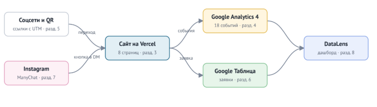

# Сайт турклуба, сквозная аналитика и бронирование мест в походах из социальных сетей

Курсовая работа по дисциплине ОП.03 «Информационные технологии», ТЗ № 01/2026.
Исполнитель: @DXlol112, группа 1.

Турклуб «Тропа» организует однодневные и выходные походы по горам и озёрам вокруг Новоозёрска с 2020 года. С
нами ходят около 2 000 человек в год, группа — до 16 человек с двумя инструкторами.

Места в походах заканчиваются быстро, а бронь сейчас оформляется в переписке: человек пишет в Instagram или
ВКонтакте, инструктор проверяет список группы в своей таблице и отвечает. Если ответ задерживается, место занимает
другой. В сентябре 2026 года 58 человек написали в группы, где мест уже не было, и мы не предложили им другие
даты.



## Ссылки

| Что | Ссылка |
|---|---|
| Сайт | [https://dxlol112.github.io/tz-11-turklub-tropa/](https://dxlol112.github.io/tz-11-turklub-tropa/)|
| Таблица заявок | [Таблица заявок](https://docs.google.com/spreadsheets/d/1S3dj2mVHnYTkhYRlXSbk8RAz_gYbAO4Xotx75UuMREk/edit?usp=sharing) |
| Дашборд DataLens | ___ |
| Instagram и Reel с автоответом(Заменено на тг бота) | [Telegram bot](https://t.me/turklubtropaBot) |
| ВКонтакте · Telegram · YouTube | ___ · ___ · ___ |
| Описание работы | [docs/opisanie.md](docs/opisanie.md) |
| Презентация к защите | [presentation/zashchita.pdf](presentation/zashchita.pdf) |

Ресурс GA4: `G-G-W8SQ3LHX0Z`.

## Что сделано

| Часть | Результат |
|---|---|
| Сайт | 8 страниц, статический HTML, Github Pages, Lighthouse: 85/100/100 |
| GA4 | 20 событий, 7 пользовательских параметров, ключевые: `generate_lead`, `contact_click` `messenger_click`|
| UTM | 12 размещений в реестре: 10 полных ссылок |
| Заявки | форма → Apps Script → лист `leads`, проверка полей и повторов |
| Instagram | ManyChat, две ветки: [TG · Winter Trips 2026 · Beginners](https://app.manychat.com/flowPlayerPage?share_hash=5733834_e4e8bcba771a07e83937ef04a083db33ae6b3a67) и [TG · Winter Trips 2026 · Gear](https://app.manychat.com/flowPlayerPage?share_hash=5733834_81e0265bd504eb20c4322c4e45c259a5757e42f0) |
| Отчёты | Reports, Explore, воронка, путь, дашборд DataLens из трёх вкладок |

## Технологии

HTML, CSS, JavaScript · Google Analytics 4 · Google Таблицы и Apps Script ·
ManyChat · Yandex DataLens · GitHub . Сайт создан с помощью codex
(запросы — в [docs/prompts.md](docs/prompts.md)).

## Структура

```text
index.html …         страницы сайта
js/analytics.js      все события GA4
apps-script/Code.gs  приёмник заявок
docs/                описание, реестр UTM, события, записка, схема
screens/             кадры-доказательства по разделам ТЗ
presentation/        презентация к защите
```

## Итог

Не получилось:
    В связи с тем, что я забанен в Instagram, использовал альтернативы виде тг бота для задания с ManyChat, а также использовал github pages вместо vercel.

Нейросеть использовалась для:
    Создания сайта, создании фото и проверки.
