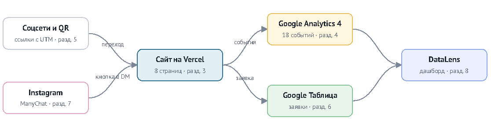
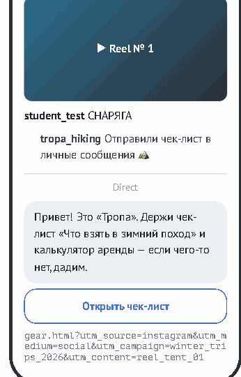
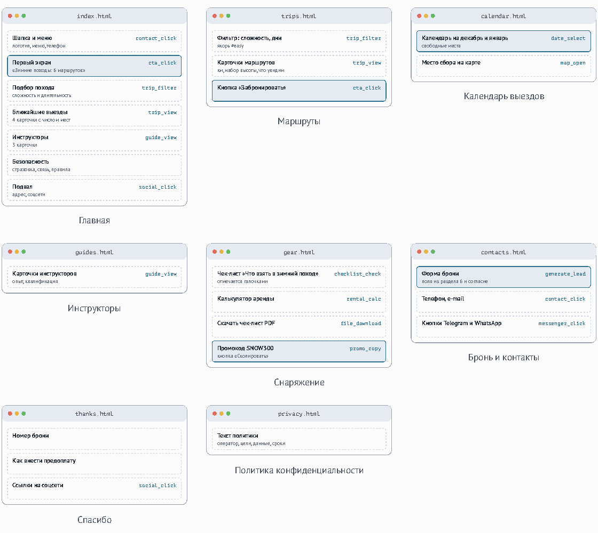

# Техническое задание № ТЗ-11/2026

Сайт турклуба, сквозная аналитика и бронирование мест в походах из социальных сетей.

Источник: [TZ-11_Turklub_Tropa.pdf](.github/TZ-11_Turklub_Tropa.pdf).

> Кейс ОП.03: организация, реквизиты, печать и подписи вымышлены.

<!-- Страница 1 из 17 -->

**ТРОПА — походы выходного дня**

Общество с ограниченной ответственностью «Тропа».

614 170, г. Новоозёрск, ул. Таёжная, д. 3, офис 2.

ИНН 9911 230 805 · КПП 991101001 · ОГРН 1209900023082.

+7 (900) 111-11-31 · go@tropa-club.example.

Исх. № 11/10-Т от 08.10.2026.

**УТВЕРЖДАЮ:** генеральный директор ООО «Тропа» С. И. Ковалёв. «08» октября 2026 г.

ТЕХНИЧЕСКОЕ ЗАДАНИЕ № ТЗ-11/2026

Сайт турклуба, сквозная аналитика и бронирование мест в походах из социальных сетей

Создание сайта с помощью нейросети, календарь выездов и калькулятор аренды снаряжения, Google Analytics 4, UTM-разметка, автоответы в Instagram, учёт заявок в таблице, дашборд в Yandex DataLens

| Параметр | Значение |
| --- | --- |
| Заказчик | Общество с ограниченной ответственностью «Тропа» |
| Исполнитель | студент<br>фамилия, имя, группа |
| Руководитель проекта со стороны<br>Заказчика | Руководитель направления «Походы» Агеева Ксения Тимуровна, trips@tropa-club.example, Telegram @tropa_trips |
| Основание | Практическая работа по дисциплине ОП.03 «Информационные технологии» |
| Дата выдачи |  |
| Срок выполнения | 21 календарный день с даты выдачи; промежуточные этапы — в разделе 9 |
| Версия документа | 1.0 |

## Содержание

Обращение Заказчика; 1. Цели проекта; 2. Сведения о компании; 3. Требования к сайту; 4. Веб-аналитика GA4; 5. UTM-разметка и соцсети; 6. Приём заявок; 7. Автоответы в Instagram; 8. Отчётность; 9. Этапы и сроки; 10. Порядок приёмки; 11. Что сдаётся; 12. Оценка; Приложение А. Схемы страниц; Приложение Б. Лист согласования; Приложение В. Акт сдачи-приёмки.

<!-- Страница 2 из 17 -->

Исполнителю по техническому заданию № ТЗ-11/2026

## Обращение Заказчика. О задачах проекта

Турклуб «Тропа» организует однодневные и выходные походы по горам и озёрам вокруг Новоозёрска с 2020 года. С нами ходят около 2 000 человек в год, группа — до 16 человек с двумя инструкторами.

Места в походах заканчиваются быстро, а бронь сейчас оформляется в переписке: человек пишет в Instagram или ВКонтакте, инструктор проверяет список группы в своей таблице и отвечает. Если ответ задерживается, место занимает другой. В сентябре 2026 года 58 человек написали в группы, где мест уже не было, и мы не предложили им другие даты.

Зимой походов меньше, но они дороже, и в них чаще идут новички без снаряжения. Половина вопросов в переписке — «Что взять?» и «Можно ли арендовать?».

В декабре 2026 года запускаем 6 зимних маршрутов, продажа мест начинается 1 ноября. К этой дате нужен сайт с каталогом походов, календарём выездов, расчётом аренды снаряжения и формой брони. Каждая бронь должна попадать в таблицу с походом, датой, числом участников и источником. Статус в таблице показывает, на каком этапе обработки находится обращение.

Сайт можно создать с помощью нейросети. Требования и порядок приёмки изложены ниже. По вопросам содержания обращайтесь к руководителю направления «Походы».

| Участников в год | Человек в группе | Не получили другую дату | Зимних маршрутов |
| --- | --- | --- | --- |
| 2 000 | 16 | 58 | 6 |

Генеральный директор С. И. Ковалёв ООО «Тропа»

<!-- Страница 3 из 17 -->

## 1. Цели проекта

Термины «должен», «обязательно» обозначают требования, которые проверяются при приёмке. Требование, помеченное «по выбору», выполняется по решению Исполнителя и даёт дополнительные баллы.

1. Получить сайт из 8 страниц, через который продаются места в зимних походах.

2. Видеть по каждому каналу (Instagram, ВКонтакте, Telegram, YouTube, блогеры, QR-код в магазине снаряжения) число посетителей и броней.

3. Собирать брони в одну таблицу с походом, датой, числом участников, источником и статусом.

4. Отвечать на вопрос «Что взять?» чек-листом на сайте и автоответами в Instagram.

5. Вести бронь по статусам в таблице от заявки до участия в походе.

Схема результата

Схема показывает путь посетителя и данных после выполнения задания. Номер у каждого блока — раздел задания, в котором он описан.



## 2. Сведения о компании для наполнения сайта

Тексты сайта составляются только по этим сведениям. Цены, адреса, режим работы и названия услуг, которых здесь нет, на сайте не публикуются.

| Раздел | Сведения |
| --- | --- |
| Зимние<br>маршруты | «Ледяные водопады» — 1 день, легко, 3 500 ₽; «Снегоступы для начинающих» — 1 день, легко, 2 900 ₽; «Рассвет<br>на Седой горе» — 1 день, средне, 3 900 ₽; «Снежное плато» — 2 дня, средне, 7 900 ₽; «Лыжный траверс» — 3 дня,<br>сложно, 11 500 ₽; «Новогодняя изба» — 31.12–02.01, легко, 15 900 ₽. |
| В стоимости | Работа двух инструкторов, трансфер от ж/д вокзала, групповое снаряжение, горячее питание в многодневных<br>походах, страховка от несчастного случая. |
| Аренда<br>снаряжения | Цена за сутки: спальник −20 °C — 500 ₽, палатка (на двоих) — 700 ₽, снегоступы — 400 ₽, коврик — 150 ₽, горелка<br>— 200 ₽, треккинговые палки — 150 ₽. |
| Условия | Бронь — после предоплаты 30 %. Участники от 18 лет; с 12 лет — в походах «легко» вместе с родителем. Отмена<br>за 7 дней — возврат предоплаты. |
| Тон текстов | Обращение на «ты» в описаниях маршрутов, на «вы» в условиях и договоре. Сложность и километраж указывать<br>честно, без «легко» для маршрутов средней сложности. |
| Фирменные<br>цвета | Синий лёд #2B6F8F, оранжевый #F08A24, снежный #F4F8FA, графит #1F2A30. Шрифты — Russo One для<br>заголовков и Inter для текста (Google Fonts). |

<!-- Страница 4 из 17 -->

Адрес, телефон и e-mail компании — в шапке этого документа. Домен tropa-club.example не используется: сайт публикуется по адресу Vercel.

## 3. Требования к сайту

### 3.1. Создание сайта с помощью нейросети

Исполнитель выбирает инструмент сам: v0, Lovable, Bolt.new, Cursor, Claude, ChatGPT, DeepSeek, GigaChat, YandexGPT или другой. Инструмент и версия указываются в docs/prompts.md .

Результат — статические файлы HTML, CSS и JavaScript, которые открываются в браузере без сборки. Сайты на React, Next.js и других фреймворках со сборкой не принимаются: если инструмент выдал такой проект, Исполнитель просит переписать его на обычный HTML.

Все запросы к нейросети сохраняются в docs/prompts.md в порядке отправки: номер, текст запроса, что получилось, что пришлось исправить вручную. Минимум — запрос на структуру сайта, отдельный запрос на каждую страницу и запросы на исправления.

Тексты интерфейса — на русском языке. Заглушки вида «Lorem ipsum», «Заголовок», «Ваш текст» не допускаются. При приёмке Заказчик выбирает любой фрагмент JavaScript из js/ , и Исполнитель объясняет, что делает каждая строка этого фрагмента.

### 3.2. Состав страниц

Сайт состоит из 8 страниц и страницы 404.html . Схемы страниц с расположением блоков — в Приложении А. Порядок блоков на странице обязателен, оформление выбирает Исполнитель.

| Файл | Страница и назначение | Обязательные блоки | События |
| --- | --- | --- | --- |
| index.html | Главная<br>Показать зимние маршруты и<br>привести к брони. | Шапка и меню; Первый экран; Подбор похода;<br>Ближайшие выезды; Инструкторы;<br>Безопасность; Подвал | contact_click<br>cta_click<br>trip_filter<br>trip_view<br>guide_view<br>social_click |
| trips.html | Маршруты<br>Описать маршруты с фильтром. | Фильтр: сложность, дни; Карточки маршрутов;<br>Кнопка «Забронировать» | trip_filter<br>trip_view<br>cta_click |
| calendar.html | Календарь выездов<br>Показать даты и свободные места. | Календарь на декабрь и январь; Место сбора<br>на карте | date_select<br>map_open |
| guides.html | Инструкторы<br>Познакомить с инструкторами. | Карточки инструкторов | guide_view |
| gear.html | Снаряжение<br>Страница, на которую ведёт ссылка<br>из автоответа в Instagram. | Чек-лист «Что взять в зимний поход»;<br>Калькулятор аренды; Скачать чек-лист PDF;<br>Промокод SNOW300 | checklist_check<br>rental_calc<br>file_download<br>promo_copy |
| contacts.html | Бронь и контакты<br>Принять бронь. | Форма брони; Телефон, e-mail; Кнопки<br>Telegram и WhatsApp | generate_lead<br>contact_click<br>messenger_click |
| thanks.html | Спасибо<br>Подтвердить бронь. | Номер брони; Как внести предоплату; Ссылки<br>на соцсети | social_click |
| privacy.html | Политика конфиденциальности<br>Описать обработку персональных<br>данных (152-ФЗ). | Текст политики | — |

<!-- Страница 5 из 17 -->

### 3.3. Общие требования

Единые шапка и подвал на всех страницах. В меню выделен пункт текущей страницы. Страницы корректно отображаются при ширине окна 375, 768 и 1280 пикселей: без горизонтальной прокрутки, текст не выходит за края, кнопки нажимаются пальцем (не менее 44 × 44 px).

У каждой страницы свой &lt;title&gt; , &lt;meta name="description"&gt; и теги Open Graph: og:title , og:description , og:image (картинка 1200 × 630). По ним соцсети строят превью ссылки. Подключён значок сайта (favicon).

Изображения в формате WebP или JPEG, каждое не больше 300 КБ, у каждого заполнен атрибут alt . Отчёт Lighthouse для главной страницы в мобильном режиме: Performance не ниже 70, Accessibility не ниже 90, SEO не ниже 90.

Форма содержит флажок согласия на обработку персональных данных со ссылкой на privacy.html . Флажок по умолчанию не отмечен, без него форма не отправляется.

Календарь на calendar.html: даты выездов и число свободных мест задаются массивом в JavaScript; выезд без мест показывается с подписью «Мест нет» и ссылкой на ближайшую другую дату того же маршрута.

Калькулятор аренды на gear.html: пользователь отмечает предметы и число суток; итог считается по ценам раздела 2. В форме брони нет вопросов о здоровье. Флажок «Мне есть 18 лет или я иду с родителем» обязателен.

### 3.4. Публикация

Код хранится в публичном репозитории GitHub Исполнителя с именем tz-11-turklub-tropa . В репозитории не меньше 10 коммитов с понятными сообщениями; первый коммит — исходный результат нейросети без правок.

Сайт опубликован на Vercel и обновляется автоматически после каждого push в ветку main . Адрес вида &lt;имя&gt;.vercel.app указывается в README.md .

## 4. Веб-аналитика Google Analytics 4

### 4.1. Ресурс и поток

Создан отдельный ресурс GA4 с названием «ТРОПА — сайт», часовой пояс (GMT+03:00) Москва, валюта — российский рубль. Создан веб-поток с адресом сайта на Vercel. В настройках потока включена расширенная статистика (Enhanced measurement), включая взаимодействия с формами.

Тег Google (gtag.js) с идентификатором G-… этого ресурса установлен в &lt;head&gt; каждой страницы, включая 404.html .

### 4.2. Перечень событий

Сайт отправляет 20 событий: 6 собирает расширенная статистика без кода, остальные Исполнитель программирует сам. Обязательны 18 событий; события с пометкой «по выбору» дают дополнительные баллы.

| № | Событие | Тип | Когда отправляется | Параметры |
| --- | --- | --- | --- | --- |
| 1 | page_view | авто | Открытие любой страницы | page_location page_title |
| 2 | scroll | авто | Прокрутка страницы до 90 % | percent_scrolled |
| 3 | click | авто | Переход по ссылке на внешний сайт | link_url outbound |
| 4 | file_download | авто | Скачивание PDF с сайта | file_name file_extension |
| 5 | form_start | авто | Первое взаимодействие с формой заявки | form_id |
| 6 | form_submit | авто | Отправка формы заявки | form_id |
| 7 | generate_lead<br>ключевое | рекоменд. | Таблица заявок ответила ok: true | lead_trip_id participants<br>lead_source |
| 8 | cta_click | своё | Клик по любой кнопке заявки | button_name page_section |

<!-- Страница 6 из 17 -->

| № | Событие | Тип | Когда отправляется | Параметры |
| --- | --- | --- | --- | --- |
| 9 | trip_filter | своё | Изменение фильтра маршрутов | difficulty duration_days |
| 10 | trip_view | своё | Клик по карточке маршрута | trip_id difficulty |
| 11 | date_select | своё | Выбор даты выезда в календаре | trip_id trip_date seats_left |
| 12 | guide_view | своё | Клик по карточке инструктора | guide_id |
| 13 | rental_calc | своё | Расчёт аренды снаряжения | items_count days rental_price |
| 14 | checklist_check | своё | Отметка пункта чек-листа | item_id |
| 15 | contact_click<br>ключевое | своё | Клик по телефону или e-mail | contact_type |
| 16 | messenger_click<br>ключевое | своё | Клик по кнопке Telegram или WhatsApp | messenger |
| 17 | social_click | своё | Клик по иконке соцсети в подвале или на<br>thanks.html | network page_section |
| 18 | form_error | своё | Форма не отправлена из-за ошибки поля | field_name error_type |
| 19 | promo_copy<br>по выбору | своё | Копирование промокода | promo_code |
| 20 | map_open<br>по выбору | своё | Клик по ссылке на место сбора | map_service |

### 4.3. Правила программирования событий

Все вызовы gtag('event', …) находятся в одном файле js/analytics.js , который подключён на всех страницах. В разметке кнопки описываются атрибутами, например data-event="cta_click" data-button-name="hero_trial" , а analytics.js находит такие элементы и отправляет событие.

Имена событий и параметров — латиница в нижнем регистре со знаком подчёркивания (snake_case), не длиннее 40 символов. Значения параметров — не длиннее 100 символов.

В GA4 не передаются имя, телефон и e-mail посетителя — ни в параметрах, ни в адресе страницы. Это запрещено правилами Google Analytics. Событие generate_lead отправляется только после того, как приёмник заявок (раздел 6) ответил {"ok": true} . При ошибке приёмника отправляется form_error с error_type = "server" .

В docs/events.md Исполнитель ведёт таблицу событий: имя, где отправляется (файл и строка), параметры с примерами значений.

### 4.4. Пользовательские параметры

Чтобы значения параметров были видны в отчётах, их регистрируют в разделе Admin → Custom definitions как параметры уровня события (Event scope). Обязательны следующие 7:

| Параметр | Событие | Какой вопрос отчёта закрывает |
| --- | --- | --- |
| button_name | cta_click | Какая кнопка заявки сработала |
| page_section | cta_click social_click | В каком блоке страницы был клик |
| difficulty | trip_filter trip_view | Какую сложность выбирают |
| trip_id | trip_view date_select | Какие маршруты смотрят |
| seats_left | date_select | Бронируют ли, когда мест мало |
| lead_trip_id | generate_lead | Маршрут в брони |
| messenger | messenger_click | Какой мессенджер выбирают |

<!-- Страница 7 из 17 -->

### 4.5. Ключевые события

Ключевыми событиями (Key events) отмечены: generate_lead , contact_click , messenger_click . Других ключевых событий в ресурсе нет.

### 4.6. Проверка

Каждое событие из таблицы 4.2 проверено в DebugView: снимок экрана с событием и раскрытыми параметрами сохраняется в screens/ga4/ под именем события, например trip_filter.png . Режим отладки включается расширением Google Analytics Debugger или параметром debug_mode: true в gtag('config', …) ; перед сдачей отладочный режим в коде отключается.

## 5. UTM-разметка и размещение ссылок в социальных сетях

Все ссылки на сайт в соцсетях, у партнёров и на афише размечаются UTM-метками — продажа мест в зимних походах, декабрь 2026. Без меток переходы из приложений соцсетей попадают в GA4 как прямые заходы (Direct), и источник заявки теряется.

### 5.1. Правила написания меток

1. Только строчные латинские буквы, цифры и знак подчёркивания. Пробелы, дефисы и кириллица не используются.

2. utm_medium — из списка: social , affiliate , qr , email , cpc , referral .

3. utm_campaign содержит повод и период: winter_trips_2026 .

4. utm_content различает размещения внутри одного источника: post_01 , stories_01 , reel_01 .

5. Метки стоят после ? и до # , если в адресе есть якорь.

6. Ссылка сначала вносится в реестр, затем публикуется. Ссылки по памяти и копии чужих ссылок не публикуются.

### 5.2. Реестр ссылок

Ячейки «заполнить» Исполнитель заполняет сам по правилам 5.1. Для блогеров utm_source — ник партнёра латиницей, utm_content — формат размещения. Пустая страница назначения — Исполнитель выбирает её сам и объясняет выбор в реестре.

| № | Канал | Размещение | source | medium | campaign | content | Страница |
| --- | --- | --- | --- | --- | --- | --- | --- |
| U-01 | Instagram | ссылка в<br>шапке<br>профиля | instagram | social | winter_trips_2026 | bio | index.html |
| U-02 | Instagram | автоответ<br>под Reel<br>(ManyChat) | instagram | social | winter_trips_2026 | reel_tent_01 | gear.html |
| U-03 | Instagram | автоответ,<br>ветка<br>«НОВИЧОК» | instagram | social | beginners_dec_2026 | reel_tent_01_easy | trips.html#easy |
| U-04 | Instagram | ссылка-<br>стикер в<br>Stories | instagram | social | winter_trips_2026 | заполнить | calendar.html |
| U-05 | ВКонтакте | пост в<br>сообществе | vk | social | winter_trips_2026 | post_01 | trips.html |
| U-06 | ВКонтакте | фотоотчёт<br>из похода | vk | social | заполнить | photo_report | calendar.html |
| U-07 | Telegram | пост в<br>канале | telegram | social | winter_trips_2026 | post_01 | calendar.html |
| U-08 | Telegram | сообщение<br>в чате<br>участников | telegram | заполнить | winter_trips_2026 | members_chat | calendar.html |

<!-- Страница 8 из 17 -->

| № | Канал | Размещение | source | medium | campaign | content | Страница |
| --- | --- | --- | --- | --- | --- | --- | --- |
| U-09 | YouTube | описание<br>видео<br>«Снежное<br>плато за 2<br>дня» | youtube | social | winter_trips_2026 | заполнить | trips.html |
| U-10 | Блогер 1 | ссылка у<br>партнёра | заполнить | affiliate | winter_trips_2026 | заполнить | index.html |
| U-11 | Блогер 2 | ссылка у<br>партнёра | заполнить | affiliate | winter_trips_2026 | заполнить | gear.html |
| U-12 | Магазин | QR-код на<br>стойке<br>магазина<br>снаряжения | gearshop_qr | qr | winter_trips_2026 | counter_a4 | gear.html |

Пример готовой ссылки для строки U-02: https://&lt;адрес-сайта&gt;.vercel.app/gear.html?utm_source=instagram&amp;utm_medium=social&amp;utm_campaign=winter_trips_2026&amp;utm_content=reel_tent_01

### 5.3. Ведение реестра

Реестр ведётся в Google Таблице на листе utm и выгружается в репозиторий как docs/utm.csv . Столбцы: номер, канал, размещение, пять меток, страница, полная ссылка, короткая ссылка, адрес публикации, дата публикации.

Полная ссылка собирается формулой из столбцов меток (например, =СЦЕПИТЬ(…) ). Вручную ссылки не набираются. Для ВКонтакте и Telegram дополнительно создаются короткие ссылки ( vk.cc или clck.ru ). После перехода по короткой ссылке в адресной строке сохраняются все пять меток — это проверяется и фиксируется снимком.

Для строки с QR-кодом создаётся QR-код полной ссылки в формате PNG ( docs/qr-u-12.png ) и афиша формата A4 с этим кодом ( docs/afisha.pdf ).

### 5.4. Размещение

Ссылки размещаются в настоящих публикациях не менее чем в четырёх соцсетях: Instagram, ВКонтакте, Telegram и YouTube. Если в одной из них нет возможности публиковаться, её заменяет Дзен, TikTok или Pinterest — замена указывается в реестре.

Для проекта создаются отдельные страницы, сообщество и канал от имени компании. Личные страницы Исполнителя для публикаций не используются. Роль блогеров-партнёров выполняют двое других студентов группы: каждый публикует ссылку Исполнителя у себя (сторис, пост или сообщение в канале) и переходит по ней. Их ники указываются в utm_source .

### 5.5. Отработка ссылок

Каждая ссылка реестра проверяется переходом из самой публикации: нажатием на ссылку в приложении или на сайте соцсети. Вставка ссылки в адресную строку проверкой не считается. Порядок проверки одной ссылки:

1. Открыть публикацию с другого устройства или в окне инкогнито и нажать на ссылку.

2. Убедиться, что в адресной строке сайта есть все метки строки реестра, и сделать снимок.

3. Найти визит в GA4 Realtime: карточка с источником ( First user source или Session source ) показывает значение utm_source .

4. Для строк U-01, U-05, U-07, U-09, U-10, U-11, U-12 дополнительно отправить заявку с именем «Тест U--номер», например «Тест U-05». В таблице заявок у этой строки метки совпадают с реестром.

Через 24–48 часов после проверок в отчёте Reports → Acquisition → Traffic acquisition при группировке по Session source / medium видно не меньше шести разных пар источника и канала из реестра. Снимок отчёта — screens/utm/traffic-acquisition.png .

<!-- Страница 9 из 17 -->

## 6. Приём заявок: форма, Apps Script и Google Таблица

### 6.1. Таблица заявок

Google Таблица называется «Tropa — Bookings», лист с заявками — leads . Одна строка — одна заявка. Первая строка — заголовки в указанном порядке:

| Столбец | Тип | Откуда значение | Обязательно |
| --- | --- | --- | --- |
| request_id | текст | Создаёт форма: REQ- + UUID | да |
| created_at | дата и время | Ставит Apps Script | да |
| name | текст | Поле формы, 2–60 символов | да |
| phone | текст | Поле формы, +7 и 10 цифр | да |
| email | текст | Поле формы, проверка формата | нет |
| trip_id | список | icefalls, snowshoes, sunrise, plateau, traverse, newyear_hut | да |
| trip_date | дата | Дата выезда из календаря | да |
| participants | число | 1–6 человек в одной брони | да |
| utm_source | текст | Из адреса страницы; пусто → direct | да |
| utm_medium | текст | Из адреса; пусто → none | да |
| utm_campaign | текст | Из адреса; пусто → not_set | да |
| utm_content | текст | Из адреса; пусто → not_set | да |
| status | список | Ставит Apps Script: new | да |

Столбец status заполняется из выпадающего списка: new , contacted , prepaid , went , lost . Ввод другого значения отклоняется проверкой данных. Пустые обязательные ячейки и повторяющиеся request_id подсвечиваются условным форматированием.

Доступ на просмотр открыт по ссылке для e-mail Заказчика, указанного при выдаче задания.

### 6.2. Приёмник заявок

Веб-приложение Apps Script с функцией doPost(e) принимает данные формы и дописывает строку в лист leads . За основу берётся приёмник из темы 7 курса. Приёмник сам проверяет обязательные поля, формат телефона и e-mail, допустимые значения списков и длину строк (не более 200 символов). При ошибке возвращает {"ok": false, "error": "…"} и строку не записывает.

Повторная отправка с тем же request_id не создаёт вторую строку.

created_at и status = new ставит приёмник. Значение status , присланное из браузера, игнорируется. Код приёмника хранится в репозитории: apps-script/Code.gs . Идентификатор таблицы в коде допускается, пароли и ключи — нет.

### 6.3. Форма на сайте

Поля пользователя: name , phone , email , trip_id , trip_date , participants , флажок согласия.

Скрытые поля request_id , utm_source , utm_medium , utm_campaign , utm_content заполняет JavaScript: метки читаются из адреса страницы и сохраняются в sessionStorage , чтобы не потеряться при переходе посетителя по страницам сайта до отправки формы.

Форма отправляется без перезагрузки страницы ( fetch ). Во время отправки кнопка неактивна. После ответа ok: true посетитель попадает на thanks.html , где показан номер его заявки. При ошибке поле подсвечивается, под ним выводится понятный текст ошибки, отправляется событие form_error .

<!-- Страница 10 из 17 -->

### 6.4. Статусы заявок

Работа с заявкой ведётся в той же таблице. Сотрудник меняет status , когда заявка переходит на следующий этап:

| status | Этап |
| --- | --- |
| new | Новая бронь |
| contacted | Связались |
| prepaid | Предоплата внесена |
| went | Участвовал в походе |
| lost | Отказ |

Одна тестовая заявка проведена по всем статусам до went , другая закрыта статусом lost . По этим заявкам проверяется вкладка «Заявки» дашборда (8.4).

## 7. Автоответы в Instagram через ManyChat

Под Reel «Ночёвка в палатке при −15 °C» пользователь пишет комментарий с ключевым словом. ManyChat отвечает в комментариях и отправляет в Direct сообщение с кнопкой. Кнопка ведёт на сайт по ссылке U-02 из реестра.

| Параметр | Значение |
| --- | --- |
| Аккаунт | Профессиональный аккаунт Instagram (Автор или Бизнес),<br>созданный для проекта |
| Автоматизация | IG · Winter Trips 2026 · Tent Reel |
| Триггер | Комментарий к конкретному Reel (Specific Post or Reel), ключевое<br>слово СНАРЯГА |
| Ответ в<br>комментарии | «Отправили чек-лист в личные сообщения 🏔 »<br>«Проверь директ — там список снаряжения»<br>«Готово! Чек-лист и промокод уже в сообщениях»<br>три варианта, ManyChat выбирает случайный |
| Сообщение в<br>Direct | «Привет! Это «Тропа». Держи чек-лист «Что взять в зимний поход»<br>и калькулятор аренды — если чего-то нет, дадим.» |
| Кнопка | «Открыть чек-лист» → ссылка U-02 |



### 7.1. Вторая ветка

В той же автоматизации или во второй автоматизации к тому же Reel ключевое слово НОВИЧОК отправляет другое сообщение: «Три зимних маршрута, которые проходят без опыта, — по кнопке ниже.» с кнопкой «Маршруты для новичков» и ссылкой U-03 ( utm_campaign=beginners_dec_2026 , utm_content=reel_tent_01_easy ).

### 7.2. Проверка

1. Автоматизация переведена в режим Live.

2. Со второго аккаунта Instagram оставлен комментарий с каждым ключевым словом. Получены ответ в комментариях и сообщение в Direct (на тестовом аккаунте оно может прийти в папку «Запросы»).

3. Нажата кнопка в сообщении. В адресе открывшейся страницы есть все метки строки реестра.

4. С этой страницы отправлена заявка. В таблице заявок у неё utm_source=instagram и utm_content из реестра; в GA4 Realtime видно событие generate_lead .

Снимки каждого шага сохраняются в screens/instagram/ . Если сообщение не приходит, проверяются по порядку: ключевое слово, выбранный Reel, статус Live, подключение Instagram в ManyChat. Частые повторные комментарии с

<!-- Страница 11 из 17 -->

одного аккаунта Instagram может ограничить — между проверками выдерживается пауза не меньше 2 минут.

## 8. Отчётность

Отчёты строятся после того, как в ресурсе накопились данные проверок разделов 5–7, то есть не раньше чем через 24– 48 часов после них. Период во всех отчётах — от первой проверки до дня сдачи (Custom). Каждый отчёт сохраняется снимком в screens/reports/ или screens/explore/ под именем из таблицы.

### 8.1. Стандартные отчёты (Reports)

| Отчёт | Настройка | Снимок |
| --- | --- | --- |
| Reports snapshot | Период проверок и сравнение с предыдущим периодом (Compare → Preceding<br>period) | snapshot.png |
| User acquisition | Группировка First user source / medium | user-acquisition.png |
| Traffic acquisition | Группировка Session source / medium , дополнительный параметр<br>(Secondary dimension) Session campaign ; второй снимок — с<br>дополнительным параметром Session manual ad content | traffic-campaign.png ,<br>traffic-content.png |
| Landing page | Engagement → Landing page, дополнительный параметр Session source | landing-source.png |
| Pages and screens | Столбцы Views, Active users, Average engagement time | pages.png |
| Events | Event count и Total users для generate_lead , cta_click , trip_filter ,<br>trip_view , date_select | events.png |
| Key events | Отчёт по ключевым событиям с разбивкой по Session source / medium | key-events.png |
| Tech | Tech details, группировка Device category | tech.png |

В отчёте Traffic acquisition созданы два сравнения (Comparisons): Session source exactly matches instagram и Session source exactly matches (direct) . Снимок отчёта с обоими сравнениями — comparison.png . Отчёт Traffic acquisition выгружен через Share this report → Download file в CSV: docs/reports/traffic-acquisition.csv .

В разделе Library создана коллекция «ТРОПА» с собственным отчётом «Кампания winter_trips_2026»: параметры Session source / medium , Session campaign , Session manual ad content ; показатели Sessions, Engagement rate, Key events. Коллекция опубликована и видна в левом меню Reports. Снимок — library.png .

### 8.2. Исследования (Explore)

Названия исследований начинаются с «ТРОПА ·». В исследованиях созданы два сегмента сеансов: «Instagram Sessions» ( Session source = instagram ) и «Direct Sessions» ( Session source = (direct) ).

<!-- Страница 12 из 17 -->

| Исследование | Настройка | На какой вопрос отвечает |
| --- | --- | --- |
| Свободная<br>форма | Строки: Session source / medium , Session campaign ,<br>Session manual ad content . Значения: Sessions, Engaged sessions, Key<br>events. Фильтр: кампания winter_trips_2026 . Вторая вкладка — те же строки<br>с двумя сегментами рядом | Какие размещения<br>приводят посетителей и<br>заявки; чем Instagram<br>отличается от прямых<br>заходов |
| Воронка | 5 шагов: page_view → trip_filter → cta_click → form_start →<br>generate_lead . Сначала открытая воронка (Open), затем копия вкладки с<br>закрытой (Closed). Разбивка (Breakdown) по Session source , третья вкладка —<br>по Device category . Сегменты Instagram и Direct применены к воронке | На каком шаге и из какого<br>источника теряются<br>посетители; меняется ли<br>картина на телефоне |
| Воронка со<br>временем | Копия воронки, у шага form_start ограничение «в течение 10 минут» после<br>cta_click (Time constraint) | Сколько посетителей<br>начинают заполнять<br>форму сразу после кнопки |
| Путь | Начальная точка — страница gear.html , следующие 3 шага по Page title ,<br>один узел раскрыт | Куда переходят<br>посетители из Instagram<br>после первой страницы |
| Обратный путь | Конечная точка (Ending point) — событие generate_lead , 3 предыдущих шага<br>по Event name | Что посетители делали<br>перед заявкой |

Для каждого исследования сохраняется снимок с видимым значком качества данных (Data quality indicator) в правом верхнем углу. Таблица свободной формы выгружена в CSV: docs/reports/free-form.csv .

### 8.3. Атрибуция и автоматические подсказки

Раздел «Реклама» (пути к ключевым событиям) в России не заполняется: Google Реклама не подключается. Цепочку действий перед заявкой показывает обратный путь из 8.2; в записку вносится это ограничение. Admin → Attribution settings: модель атрибуции ресурса и окно атрибуции записываются в аналитическую записку.

Создано собственное оповещение (Custom insight): ежедневная проверка, сегмент Session source = instagram , условие «Sessions уменьшились больше чем на 50 %», уведомление на e-mail Исполнителя. Снимок настроек — custom-insight.png .

### 8.4. Дашборд в Yandex DataLens

Data Studio из России недоступен, поэтому отчёт строится в Yandex DataLens. Данные GA4 выгружаются из исследования «Свободная форма» в Google Таблицу (листы ga4_traffic и ga4_leads без служебных строк и строки «Общий итог»). Дашборд «ТРОПА — winter_trips_2026» из трёх вкладок. На каждой вкладке есть закреплённый селектор периода, и он меняет все виджеты вкладки.

| Вкладка | Датасет DataLens | Состав |
| --- | --- | --- |
| Трафик | Выгрузка GA4<br>( ga4_traffic ,<br>ga4_leads ) | Индикаторы «Сеансы», «Активные пользователи», «generate_lead»; линия сеансов по<br>дням; таблица источников и кампаний; селекторы периода и источника |
| Заявки | Google Таблица, лист<br>leads | Индикаторы «Всего заявок» (COUNTD по request_id), «Новые», «Участвовал в<br>походе»; столбчатая диаграмма по статусам; заявки по источникам и по дням;<br>селектор статуса |
| Кампании | Три датасета в одной<br>таблице | Связи только по source, campaign и дате. Таблица: сеансы и generate_lead из GA4,<br>заявки из таблицы, заявки в статусе went ; заявок на 100 сеансов считается в<br>записке |

Значения (direct) и (not set) из GA4 приводятся к виду, в котором их пишет форма. Доступ к воркбуку — «Просмотр» для Заказчика, публичная ссылка не создаётся. Имена, телефоны и e-mail посетителей скрыты в датасете и на дашборде не выводятся. Снимки трёх вкладок сохраняются в screens/datalens/ .

<!-- Страница 13 из 17 -->

### 8.5. Аналитическая записка

Файл docs/report.md заполняется по шаблону в порядке шагов анализа. Все числа берутся из отчётов 8.1–8.4 за период проверок. Вывод описывает, где и у кого теряются посетители; гипотеза — возможную причину, которую можно проверить изменением на сайте.

Период: ___ — ___

1. Traffic acquisition: сеансов всего ___, из Instagram ___, по кампании winter_trips_2026 ___ Чем User acquisition отличается от Traffic acquisition на моих данных: ___

2. Landing page: главная страница входа из Instagram — ___ (___ сеансов)

3. Events: trip_filter ___ раз / ___ пользователей; cta_click ___; form_start ___; generate_lead ___

4. Свободная форма: размещение (utm_content) с наибольшим числом ключевых событий — ___ Instagram и Direct: Engagement rate ___ % и ___ %

5. Воронка (открытая): наибольшая потеря между ___ и ___ (теряется ___ %) В закрытой воронке на последнем шаге ___, в открытой ___. Причина разницы: ___

6. Разбивка: на телефоне доля дошедших до заявки ___ %, на компьютере ___ %

7. Путь: после gear.html чаще всего открывают ___

8. Обратный путь: перед generate_lead чаще всего было событие ___ Атрибуция: модель ___, окно ___ дней; самая частая цепочка ___ Заявок в таблице ___, generate_lead в GA4 ___. Причина расхождения: ___ Вывод: ___ Гипотеза и как её проверить: ___

## 9. Этапы и сроки

День 0 — дата выдачи задания. К концу каждого этапа результат загружен в репозиторий; Заказчик может проверить промежуточный результат без предупреждения.

| Этап | Срок | Результат этапа |
| --- | --- | --- |
| 1. Сайт | день 4 | Все страницы сгенерированы, доработаны по разделу 3 и опубликованы на Vercel; заполнен<br>docs/prompts.md |
| 2.<br>Аналитика | день 8 | Ресурс GA4, тег на всех страницах, события раздела 4 проверены в DebugView |
| 3. Заявки | день<br>11 | Таблица, приёмник и форма; заявки доходят до таблицы с метками |
| 4. Каналы | день<br>15 | Реестр ссылок, публикации в соцсетях, автоответы Instagram, проверки 5.5 и 7.2 |
| 5. Отчёты | день<br>19 | Отчёты и исследования GA4, атрибуция и оповещение, дашборд DataLens, аналитическая записка |
| 6. Сдача | день<br>21 | Комплект по разделу 11, испытания раздела 10 в присутствии Заказчика |

## 10. Порядок приёмки

Приёмка проходит в присутствии Исполнителя. Исполнитель заранее открывает GA4 (DebugView и Realtime), таблицу заявок, ManyChat и DataLens. Заказчик проводит испытания в указанном порядке и отмечает результат в акте (Приложение В).

| № | Что<br>проверяется | Действие Заказчика | Ожидаемый результат |
| --- | --- | --- | --- |
| И-01 | Сайт | Открыть все страницы по адресу Vercel в режиме<br>телефона (375 px) | Страницы открываются, нет горизонтальной<br>прокрутки, меню работает |
| И-02 | Тег | Открыть исходный код трёх страниц на выбор<br>Заказчика | В &lt;head&gt; есть тег с идентификатором ресурса<br>Исполнителя |

<!-- Страница 14 из 17 -->

| № | Что<br>проверяется | Действие Заказчика | Ожидаемый результат |
| --- | --- | --- | --- |
| И-03 | Контрольная<br>заявка | Заказчик выбирает строку реестра, переходит по<br>ссылке со своего телефона и отправляет заявку с<br>именем «Приёмка ТЗ-11/2026» | Не позже чем через 2 минуты в таблице есть строка<br>с метками этой строки реестра; в DebugView или<br>Realtime — generate_lead |
| И-04 | Ошибки<br>формы | Отправить форму с пустым телефоном, затем с<br>телефоном «123» | Форма не отправлена, показана ошибка у поля,<br>пришло событие form_error |
| И-05 | Повтор | Отправить в приёмник повторно запрос с<br>request_id уже записанной заявки | Вторая строка не появилась, приёмник вернул<br>ошибку |
| И-06 | События | Заказчик называет 5 событий из таблицы 4.2 | Исполнитель вызывает каждое на сайте и<br>показывает его с параметрами в DebugView |
| И-07 | Instagram | Заказчик пишет комментарий с ключевым<br>словом под Reel | Ответ в комментариях и сообщение в Direct с<br>кнопкой; ссылка кнопки совпадает с реестром |
| И-08 | Короткая<br>ссылка | Перейти по короткой ссылке ВКонтакте из<br>реестра | В адресе сайта все метки строки реестра |
| И-09 | DataLens | Изменить период на вкладке «Кампании» | Меняются все виджеты вкладки; числа заявок<br>совпадают с таблицей за тот же период |
| И-10 | Статус заявки | Перевести заявку из И-03 в таблице в статус<br>went и обновить дашборд | На вкладке «Заявки» индикатор «Участвовал в<br>походе» вырос на 1, заявка видна в своём<br>источнике |
| И-11 | Отчёты GA4 | Заказчик задаёт вопрос по данным, например «С<br>какой страницы входа из Instagram было больше<br>всего ключевых событий?» | Исполнитель за 5 минут находит ответ в Reports или<br>Explore и называет, какие параметр и показатель<br>для этого выбрал |
| И-12 | Воронка | Переключить воронку с открытой на закрытую | Числа на шагах меняются; Исполнитель объясняет<br>почему |
| И-13 | Калькулятор<br>аренды | Отметить спальник и коврик на 2 суток | Показано (500 + 150) × 2 = 1 300 ₽; в DebugView<br>пришло rental_calc с rental_price = 1300 |

Если испытание не пройдено, Исполнитель получает перечень замечаний и один раз устраняет их в течение 3 дней. Повторная проверка проводится только по непройденным испытаниям.

## 11. Что сдаётся

Всё сдаётся одной ссылкой на репозиторий GitHub. Структура репозитория:

```text
tz-11-turklub-tropa/
├── index.html trips.html calendar.html guides.html gear.html contacts.html thanks.html
privacy.html 404.html
├── css/ js/analytics.js js/form.js img/ files/
├── apps-script/Code.gs
├── docs/
│ ├── prompts.md запросы к нейросети
│ ├── events.md таблица событий
│ ├── utm.csv реестр ссылок
│ ├── images.md источники изображений
│ ├── report.md аналитическая записка
│ └── afisha.pdf, qr-*.png
├── screens/ga4/ utm/ instagram/ reports/ explore/ datalens/ lighthouse/
└── README.md ссылки на всё, что ниже
```

README.md начинается с таблицы ссылок: сайт на Vercel, таблица заявок, дашборд DataLens, публикации в каждой соцсети, Reel с автоответами. Ниже — идентификатор ресурса GA4 ( G-… ) и строка «Доступ Viewer к ресурсу GA4 выдан:

<!-- Страница 15 из 17 -->

___ (e-mail Заказчика)».

В конце README.md две строки: «Не получилось: ___» и «Нейросеть использовалась для: ___».

## 12. Оценка

| Часть работы | Разделы | Баллы |
| --- | --- | --- |
| Сайт: страницы, блоки, адаптивность, Lighthouse, публикация, журнал запросов | 3 | 15 |
| Аналитика: ресурс, тег, 18 обязательных событий с параметрами, пользовательские параметры, ключевые<br>события | 4 | 25 |
| UTM: реестр, короткие ссылки, QR, публикации в 4 соцсетях, отработка | 5 | 15 |
| Заявки: таблица с проверками, приёмник, форма | 6 | 10 |
| Автоответы Instagram с двумя ветками | 7 | 10 |
| Отчёты и исследования GA4, атрибуция, оповещение, аналитическая записка | 8.1–8.3,<br>8.5 | 10 |
| Дашборд DataLens и статусы заявок | 6.4, 8.4 | 10 |
| Оформление репозитория и снимков по разделу 11 | 11 | 5 |
| Итого |  | 100 |
| Дополнительно: события «по выбору», по 2 балла | 4.2 | +4 |

| Баллы | 90–100 | 75–89 | 60–74 | меньше 60 |
| --- | --- | --- | --- | --- |
| Оценка | 5 | 4 | 3 | работа возвращается на доработку |

Работа не принимается к оценке, если не выполнено хотя бы одно условие: сайт открывается по адресу Vercel; тег GA4 есть на всех страницах; контрольная заявка И-03 доходит до таблицы с метками.

<!-- Страница 16 из 17 -->

## Приложение А. Схемы страниц

Схема задаёт состав и порядок блоков. Справа в блоке — событие, которое он отправляет. Выделенные блоки содержат главную кнопку страницы.



<!-- Страница 17 из 17 -->

## Приложение Б. Лист согласования

| Должность | ФИО | Подпись | Дата |
| --- | --- | --- | --- |
| Генеральный<br>директор | Ковалёв Станислав Игоревич |  | 08.10.2026 |
| Руководитель<br>направления<br>«Походы» | Агеева Ксения Тимуровна |  | 08.10.2026 |
| Исполнитель: с<br>заданием<br>ознакомлен |  |  |  |

## Приложение В. Акт сдачи-приёмки

к техническому заданию № ТЗ-11/2026. Заполняется Заказчиком при приёмке.

| № | Испытание | Пройдено | Замечание |
| --- | --- | --- | --- |
| И-01 | Сайт | ☐ да ☐ нет |  |
| И-02 | Тег | ☐ да ☐ нет |  |
| И-03 | Контрольная заявка | ☐ да ☐ нет |  |
| И-04 | Ошибки формы | ☐ да ☐ нет |  |
| И-05 | Повтор | ☐ да ☐ нет |  |
| И-06 | События | ☐ да ☐ нет |  |
| И-07 | Instagram | ☐ да ☐ нет |  |
| И-08 | Короткая ссылка | ☐ да ☐ нет |  |
| И-09 | DataLens | ☐ да ☐ нет |  |
| И-10 | Статус заявки | ☐ да ☐ нет |  |
| И-11 | Отчёты GA4 | ☐ да ☐ нет |  |
| И-12 | Воронка | ☐ да ☐ нет |  |
| И-13 | Калькулятор аренды | ☐ да ☐ нет |  |

Баллы: Заказчик: место для штампа Оценка: подпись, расшифровка «Работа принята»
