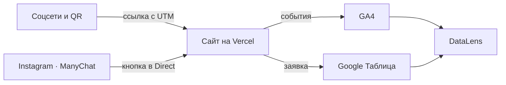
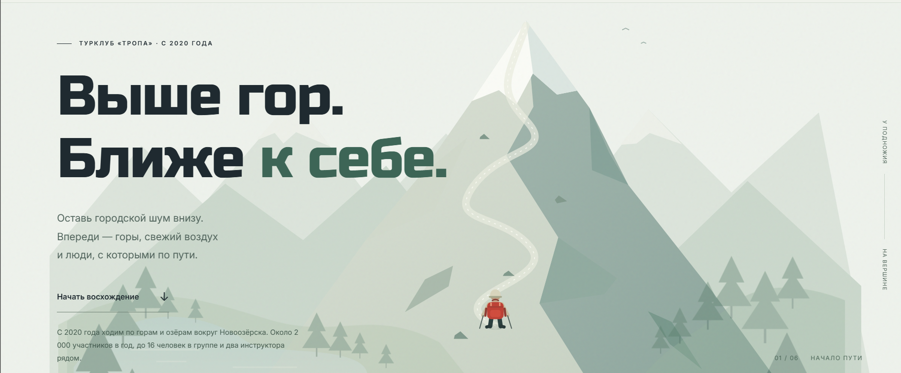
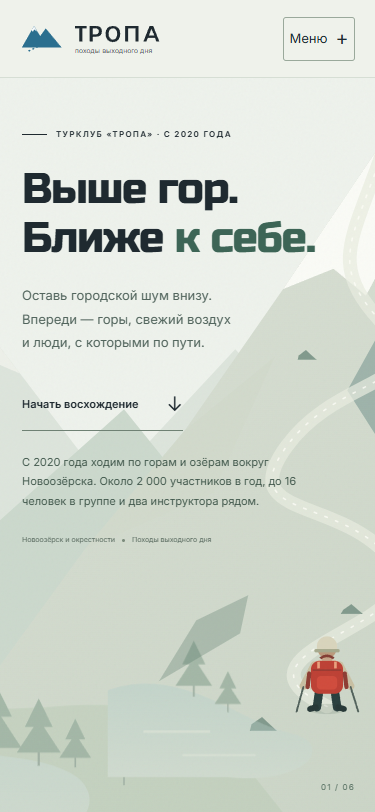

# Описание работы · ТЗ № 11 · «Сайт турклуба»

**Исполнитель:** @DXlol112, группа 1
**Сайт:** [https://dxlol112.github.io/tz-11-turklub-tropa/](https://dxlol112.github.io/tz-11-turklub-tropa/)

## 1. Задача заказчика

Компания «Тропа» получает заявки из Instagram и ВКонтакте, но не знает, какой канал приводит
клиентов. В сентябре 2026 года было ___ обращений, потеряно 58 (письмо директора в ТЗ).
Задача — сайт, на котором видно источник каждого посетителя, и одна
таблица со всеми заявками.

## 2. Схема работы

Посетитель приходит из соцсетей или по QR-коду по ссылке с UTM-метками.
Сайт отправляет события в GA4, а заявку — в Google Таблицу через Apps Script.
Данные GA4 и таблицы собираются на дашборде DataLens.

Схема на Mermaid

## 3. Сайт

Сайт из 8 страниц создан с помощью chatGPT(Astra-6) и доработан вручную: @DXlol112.
Опубликован на Vercel, обновляется после каждого push.

## 4. Аналитика GA4

Настроено 20 событий, из них своих — 14. Ключевые события: `generate_lead`, `contact_click`, `messenger_click`.
Каждое событие проверено в DebugView.

## 5. UTM-ссылки и соцсети

В реестре 10 полных ссылок, опубликованы в ___ (Instagram, ВКонтакте, Telegram,
YouTube), у двух партнёров и на афише с QR-кодом.

## 6. Заявки

Форма отправляет заявку в Apps Script, тот проверяет поля и записывает
строку в лист `leads` вместе с метками. Повторная отправка не создаёт дубль.

## 7. Автоответы в Instagram

Комментарий «СНАРЯГА» под Reel запускает ответ в комментариях и сообщение
в Direct с кнопкой на сайт. Вторая ветка — слово «НОВИЧОК».

## 8. Отчёты и дашборд

Воронка показала наибольшую потерю между ___ и ___ (___ %).
Больше всего заявок принёс канал ___.

## 9. Что получил бизнес

| Было | Стало |
|---|---|
| заявки в личных сообщениях трёх аккаунтов | все заявки в одной таблице со статусом |
| источник клиента неизвестен | у каждой заявки есть source, medium, campaign |
| бюджет делится «по ощущениям» | на дашборде видно заявки по каждому каналу |
| ответы на комментарии вручную | ManyChat отвечает сразу и ведёт на сайт |

Рекомендация заказчику: ___ (по данным из раздела 8).

## 10. Итог

Не получилось: использовать Instagram из-за блокировки аккаунта; вместо него использован Telegram-бот для ManyChat, вместо Vercel — GitHub Pages.
ИИ использовался для: создания сайта, фотографий и проверки.
